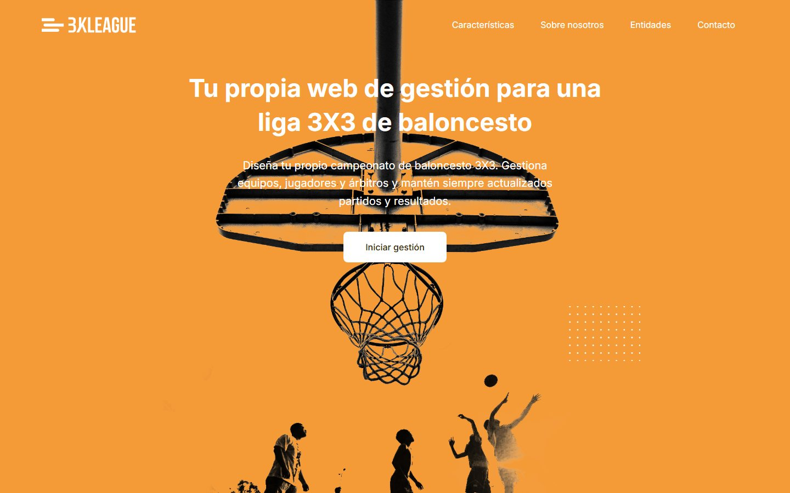
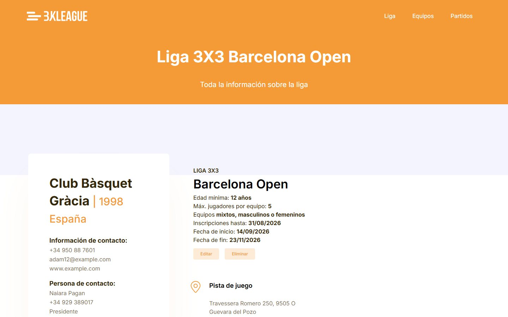
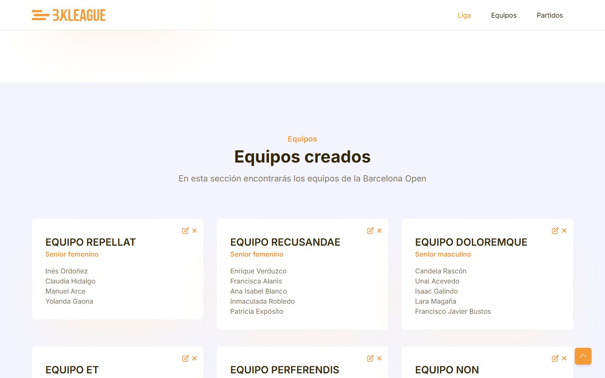
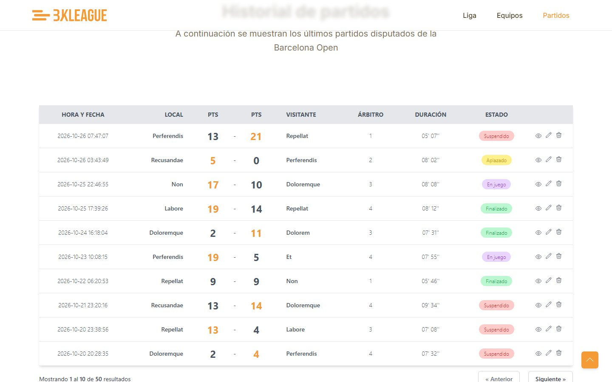
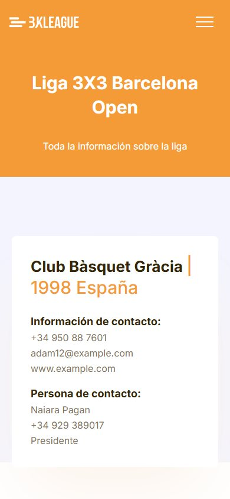

# 3X3 League

> A web app to manage a 3x3 basketball league: entities, leagues, teams, players and games. Built in 2022 with Laravel and Blade as a Full Stack PHP bootcamp project (IT Academy); in 2026 it was tidied up and moved from Laravel 9 to Laravel 13 to run on current PHP.

[](https://github.com/wavesforweirdos/3X3basketleague/actions/workflows/ci.yml)



## Features

- **Entities** (clubs or federations) with a contact person, photo and the leagues they run
- **Leagues** with their rules (minimum age, maximum players, allowed team genders), registration and play dates, and a court
- **Teams** by category and gender, each with its squad of players
- **Games** with teams, referee, score, duration and status (scheduled, in play, finished, postponed), listed newest first with pagination
- Create, edit and delete for entities, leagues, teams and games, with validation; pictures are checked (images only, up to 2 MB)
- Landing page and Spanish interface built on the TailGrids Tailwind template; responsive
- Demo data with a seeder: one entity and league, eight teams with their players and fifty games

| League | Teams |
|---|---|
|  |  |

| Games | On a phone |
|---|---|
|  |  |

## Technologies

| | |
|---|---|
| **Back end** | PHP 8.3+, [Laravel 13](https://laravel.com/), Eloquent, MySQL (SQLite for the tests) |
| **Front end** | Blade views and components, [Tailwind CSS](https://tailwindcss.com/), Alpine.js, [Vite](https://vite.dev/) |
| **Quality** | PHPUnit 12 (12 tests), GitHub Actions |

## Getting started

You need PHP 8.3+ (it runs on 8.5), Composer, Node 20+ and a MySQL database (or SQLite).

```sh
git clone https://github.com/wavesforweirdos/3X3basketleague
cd 3X3basketleague
composer install
npm install

cp .env.example .env
php artisan key:generate
```

Set your database in `.env` (`DB_*`). For SQLite, create an empty `database/database.sqlite` and use `DB_CONNECTION=sqlite` with the full path in `DB_DATABASE`. Then:

```sh
php artisan migrate --seed   # tables and demo data
php artisan storage:link     # public URL for uploaded pictures
npm run build                # CSS and JS (or `npm run dev` while developing)
php artisan serve            # http://localhost:8000
```

### Tests

```sh
vendor/bin/phpunit
```

`phpunit.xml` runs on an in-memory SQLite database, so no MySQL is needed. The tests need the Vite build (`npm run build`) because the views request their CSS and JS through `Vite::asset()`; images are plain files in `public/images`.

## Project layout

```
app/Http/Controllers/   Entity, League, Team, Game, Player and User controllers
app/Http/Requests/      validation of the forms
app/Models/             Eloquent models (names are stored lowercase and shown capitalised)
database/               migrations, factories and the demo seeder
bootstrap/app.php        routing and middleware setup (Laravel 11+ style)
resources/views/        Blade views, layouts and components
routes/web.php          the routes
tests/Feature/          page and upload tests
```

## Known limits

This is an unfinished learning project:

- **There is no authentication.** Anyone who can reach the app can create, edit and delete everything. Don't expose it to the public internet as it is: the sign-in and sign-up pages are only mock-ups
- The index pages for leagues, teams, games and players, and the player profile, were never built; their routes are disabled, so they answer 404 or 405 instead of an error
- The interface is in Spanish only

## Deployment

It needs a PHP host with a database, so it can't run on static hosting like GitHub Pages. Build the assets (`npm run build`), set the production `.env` (`APP_ENV=production`, `APP_DEBUG=false`, `APP_URL` and the database) and run `php artisan migrate --force` and `php artisan storage:link`.
